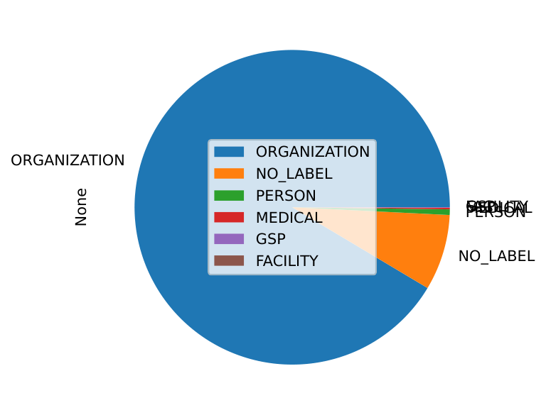
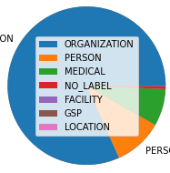
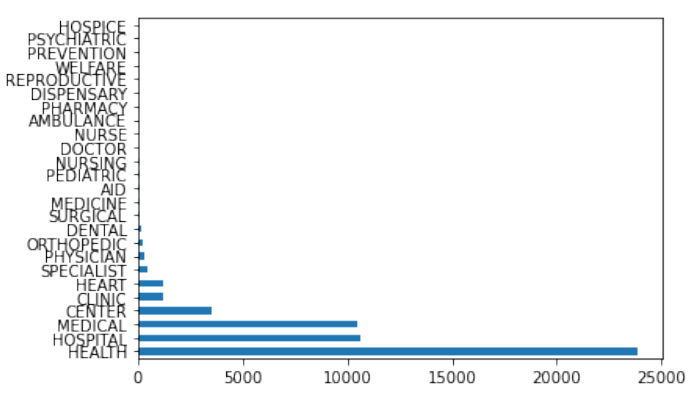
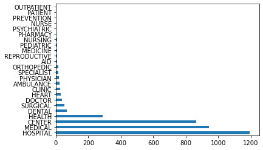
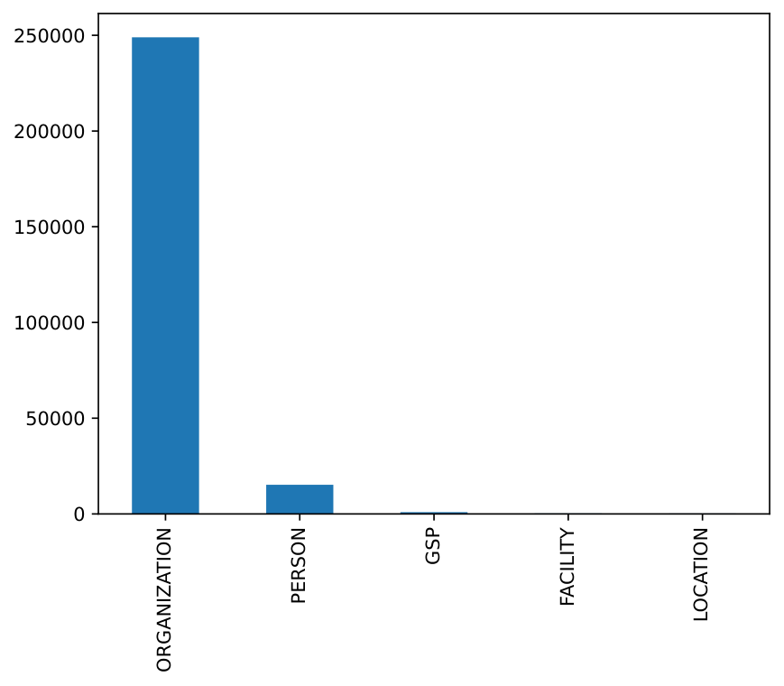
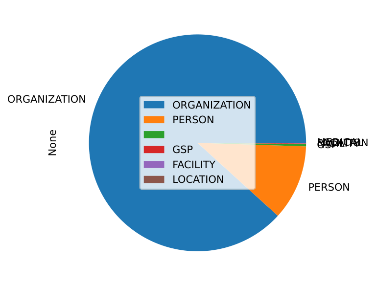

# Plaintiff Classification for Medical Debt Analysis

Independent study research project, University of Guelph, supervised by Luiza Antonie. The work spans two consecutive courses: CIS4900 (Winter 2022) laid the classification pipeline; CIS4910 (Spring 2022) built on top of it to produce the debt-analysis results.

## Overview

This project uses real U.S. civil court data from the [Civil Justice Data Commons](https://www.law.georgetown.edu/tech-institute/programs-and-initiatives/georgetown-justice-lab/civil-justice-data-commons/) (built by Georgetown Law's Massive Data Institute) to automatically classify lawsuit **plaintiffs** as **medical** or **non-medical** creditors. The goal is to support research into medical debt in the United States by identifying which civil suits are being brought by hospitals, ambulance services, clinics, and other medical providers against patients over unpaid bills — without any pre-labeled training data to work from.

## Research Project 1: CIS4900

The initial independent study course, and the bulk of the work. Per the course syllabus (`cis4900-w22Julia.pdf`), the objective was to develop software to clean and standardize civil court data, extract plaintiff information from it, and classify plaintiffs as medical or non-medical.

- Started from NLTK fundamentals: tokenizing, stemming, POS tagging, chunking, and NER on toy text (`practice/nltk-practice.py`).
- Moved to real data: keyword-based medical filtering on the Maricopa County, Arizona dataset, with the first charts.
- Extended the pipeline to a second dataset, Oklahoma.
- Added the technical core of the project: Word2Vec and GloVe embedding expansion to auto-discover medical vocabulary beyond the initial seed keywords.
- Closed out the course with a visualization/cleanup pass: a dedicated Oklahoma script, a "clarity" pass on the analysis, and notebooks reorganized and exported to PDF.

By the end of CIS4900, the project had a working end-to-end classification cascade (keyword → embedding → NER fallback) across two states' worth of civil court data, but no dollar-amount analysis yet.

## Research Project 2: CIS4910

A follow-up independent study course continuing directly from CIS4900, using the classification pipeline already built to produce an actual debt-analysis payoff, plus a correctness fix:

- `Adding a script to get medical debt numbers` — new `scripts/get_debt.py`, which extracts actual dollar debt amounts (from the `misc` JSON column) for plaintiffs already classified as medical, broken down by provider sub-category (ambulance, hospital, nursing).
- `Updating to dedup hits` — a fix to `secondary_labels.py`: the classification loop now tracks case numbers already seen and skips duplicates, so the same court case was no longer double-counted when tallying medical-related hits.

## Data Sources

Three state-level civil court datasets were used, pulled either from CSV exports or directly via the [Redivis](https://redivis.com/) client library:

- **Arizona (Maricopa County)** — `Maricopa_Pew.csv`, ~305,000 case rows / ~74,000 unique plaintiff names (Pew Charitable Trusts eviction/debt dataset).
- **Oklahoma** — `ojo_civ_cases_e.csv`, ~762,000 case rows / ~96,000 unique plaintiffs, loaded via `redivis.table("ojo_civ_cases:try5")`.
- **Maryland** — ~32,500 case rows loaded via `redivis.table("cases:16tt")`, with structured plaintiff/defendant JSON fields.

Raw datasets and notebook outputs containing real litigant names are intentionally **not** committed to this repository.

## Approach

Since plaintiff names appear only as free-text strings (e.g. `"CAPITAL ONE BANK"`, `"DEL MAR TERRACE APTS LLC"`, `"TOWER LOANS"`), classification is done with a layered NLP pipeline rather than a supervised model:

1. **Keyword matching** — flag a plaintiff as `MEDICAL` if the string contains an obvious term (`health`, `medical`, `hospital`, `clinic`).
2. **Word-embedding expansion** — starting from those seed terms, pull the nearest neighbors in both **Word2Vec** (pretrained Google News sample via NLTK) and **GloVe** (`glove-wiki-gigaword-50`) embedding spaces to discover related medical vocabulary (e.g. `outpatient`, `ambulance`, `physician`, `pharmacy`, `nursing`, `psychiatric`, `hospice`). Neighbors are manually sanitized to remove noisy, non-medical matches (`poor`, `education`, `study`, `veterinary`, etc.), then combined into three confidence tiers: found in both embedding models, Word2Vec only, or GloVe only.
3. **Named Entity Recognition (NER) fallback** — for strings with no keyword or embedding match, NLTK's POS tagging + `ne_chunk` assigns an entity type (`ORGANIZATION`, `PERSON`, `GPE`, ...) as a best-effort label.

These stages are chained into a priority cascade (exact keyword → embed-both → embed-Word2Vec → embed-GloVe → NER fallback → `NO_LABEL`), along with a **secondary label** identifying the specific term or entity type that triggered the match (e.g. `AMBULANCE`, `HOSPITAL`, `NURSE`).

### Debt amount extraction

For plaintiffs classified as medical, `scripts/get_debt.py` parses a `misc` JSON column (`Complaint Information → Amount`) to extract the actual dollar amount being claimed, and breaks totals down by provider sub-category (`AMBULANCE`, `HOSPITAL`, `NURSE`/`NURSING`).

## Results (CIS4900 Final Report)

Per the final report (`Julia Hohenadel 4900 Final Report W22.pdf`), the CIS4900 course was initially given four Civil Justice Data Commons datasets — Philadelphia, Maricopa County (AZ), Oklahoma, and Maryland — but Philadelphia and Maricopa turned out to be **eviction-only** data, which doesn't bear on medical debt. So the paper's actual medical-classification results are drawn only from **Oklahoma** (762,511 rows) and **Maryland** (32,534 rows, parsed from nested plaintiff JSON):

| Dataset | Basic keyword filtering | + Word embeddings (combined) |
|---|---|---|
| Oklahoma | 6.25% flagged `MEDICAL` | 7.11% flagged `MEDICAL` (+0.85 pts) |
| Maryland | 7.55% flagged `MEDICAL` | 11.42% flagged `MEDICAL` (+3.72 pts) |

Maryland's richer JSON (address, business name, etc., not just the plaintiff's name) consistently produces a higher flag rate than Oklahoma's plaintiff-name-only string. Of the two embedding models, **GloVe** did the heavy lifting — it alone accounts for ~85% of Oklahoma's and ~80% of Maryland's embedding-only matches, largely because GloVe's neighbor set includes the word "center," a frequent but false-positive-prone term (e.g. daycare centers getting flagged as medical).

## Sample Visualizations

The Maricopa/eviction charts below (`ner.png`, `ner_pie.png`, `ner_pie2.png`, `frequency.png`) are from early CIS4900 exploration, before the course settled on Oklahoma and Maryland as the two datasets actually relevant to medical debt. The rest are rendered from the source PDFs in `pdfs/` (Oklahoma/Maricopa notebooks) or extracted directly from the final report PDF (Maryland, and both datasets' word-frequency charts, which aren't otherwise in this repo).

**Final report results — Oklahoma and Maryland (Tables VI–VIII):**

| | |
|---|---|
|  |  |
| Oklahoma plaintiff classification after basic keyword filtering: mostly `ORGANIZATION`/`NO_LABEL`, with a `MEDICAL` slice. | Maryland's classification after the same basic keyword filtering — a noticeably larger `MEDICAL` slice, thanks to its richer JSON data. |
|  |  |
| Word frequency behind Oklahoma's medical flags — `health`, `hospital`, `medical` dominate, with `center` (a GloVe false-positive source) a close fourth. | Same for Maryland — `hospital`, `medical`, `center` dominate, with `center` an even larger share here due to address-based false positives. |

**Early exploration — Maricopa (eviction data, excluded from final medical-debt results):**

| | |
|---|---|
|  |  |
| Named entity counts across ~305k Maricopa plaintiff strings — the vast majority tag as `ORGANIZATION`, a smaller share as `PERSON`. | Same data as a pie chart, with legend. |

There's also `pdfs/frequency.pdf` / `images/frequency.png` — a word-frequency distribution over lemmatized Maricopa plaintiff names — but it's not very legible at this scale (too many x-axis labels); the Oklahoma/Maryland word-frequency charts above are the readable equivalent from the final report.

## Repository Structure

```
scripts/
  nltk-practice.py              NLTK fundamentals: tokenizing, stemming, POS tagging, lemmatizing
  oklahoma.py                   Keyword-based medical classification on Oklahoma data
  real-data-practice.py         Keyword + NER classification on Maricopa data
  word_embeddings.py            Word2Vec/GloVe embedding expansion of the medical vocabulary
  secondary_labels.py           Full classification cascade + secondary labels (Maricopa)
  secondary_labels_oklahoma.py  Full classification cascade + secondary labels (Oklahoma)
  get_debt.py                   Extracts and categorizes medical debt amounts from labeled data

practice/
  nltk-practice.py              Early NLTK exploration (tokenizing, chunking, NER, collocations)

images/                         PNG renders of the chart PDFs below, plus Oklahoma/Maryland charts
                                 extracted directly from the final report, for the README

pdfs/
  frequency.pdf, ner.pdf, ner_pie.pdf, ner_pie2.pdf,
  Oklahoma_Medical_Info.pdf     Charts of plaintiff word frequency and NER/medical classification splits
  oklahoma notebook.pdf,
  oklahoma notebook 2.pdf       Exported Jupyter notebooks showing the full Oklahoma analysis pipeline

output.txt                      Sample tokenizer/POS-tagger output
cis4900-w22Julia.pdf            Course syllabus
Julia Hohenadel 4900 Final Report W22.pdf   CIS4900 final report/paper — methodology + results (see above)
```

## Tech Stack

- **Python** — `pandas` for data wrangling
- **NLTK** — tokenization, POS tagging, NER (`ne_chunk`), lemmatization, frequency distributions
- **gensim** — Word2Vec and GloVe embedding models
- **matplotlib** — bar/pie chart visualizations
- **redivis** — client library for pulling case data from the Civil Justice Data Commons
